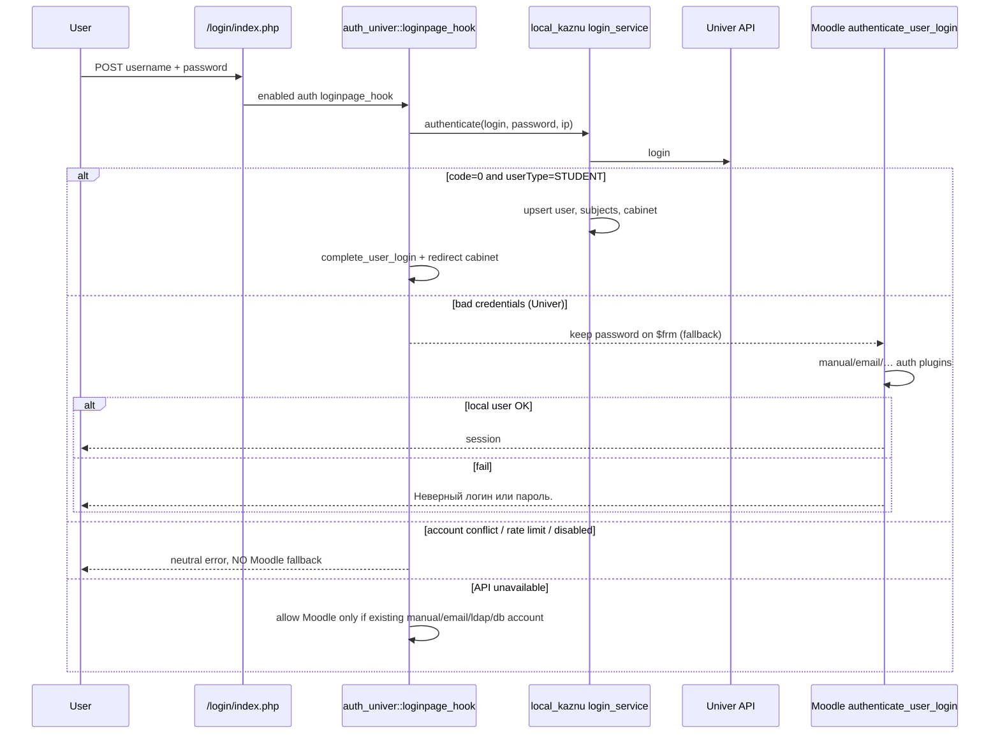

# Phase 6B — unified login (part of RC 1.0.0-portal-auth)

See also: [phase6_combined_release_review.md](phase6_combined_release_review.md) and [PHASE6_RC_MANIFEST.md](PHASE6_RC_MANIFEST.md).

**Status:** packed in workspace RC. **Production: not deployed without APPROVE.**


## 1. Login page (UX)

`/login/index.php` (theme_farabi):

```
Farabi School
Образовательная платформа
Логин
Пароль
[ Войти ]
```

Нет: «Войти через Univer», «Moodle LMS», «Студенты/Сотрудники», dual CTA, guest.

`/local/kaznu/login_univer.php` → redirect на `/login/index.php` (bookmarks / return_url).

## 2. Sequence (Univer-first → Moodle fallback)



## 3. Файлы

| Path | Change |
|------|--------|
| `auth_univer/*` | New auth plugin (primary) |
| `theme_farabi/templates/login.mustache` | Brand block |
| `theme_farabi/templates/core/loginform.mustache` | Minimal form |
| `theme_farabi/scss/post.scss` | Hide secondary login chrome |
| `theme_farabi/lang/*` | Brand + Логин/Пароль/Войти |
| `kaznu/login_univer.php` | Redirect only |
| `kaznu/db/hooks.php` | No CTA callbacks |
| `kaznu/classes/hook/login_button.php` | No-op |
| `kaznu/classes/service/user_service.php` | Create with `auth=univer` if plugin present |
| `kaznu/classes/service/login_service.php` | Docs align to unified flow |
| `kaznu/version.php` | 0.10.0 / 2026080701 |
| `auth_univer/tests/*` | Policy unit tests |
| `kaznu/cli/phase6b_unified_login_smoke.php` | Structural smoke |

No Moodle core edits.

## 4. Univer-first → Moodle fallback

Implemented in `auth_plugin_univer::loginpage_hook()`:

1. On POST runs `login_service::authenticate` first.
2. Success → `complete_login`, password wiped, redirect.
3. `BAD_CREDENTIALS` / `NOT_STUDENT` → keep `$frm->password`, Moodle core continues.
4. Hard statuses (`ACCOUNT_REVIEW`, `SYNC_FAILED`, `PROFILE_FAILED`, `RATE_LIMITED`, `DISABLED`) → redirect with generic message, **no** local auth.
5. `UNAVAILABLE` → local auth only if username exists with `manual`|`email`|`ldap`|`db`.

## 5. Security

- HTTPS gate in `login_service`
- Rate limit per login+IP
- Password never stored; cookie jar cleared after API calls
- `prevent_local_passwords` + random hash for students
- No IDP list / no dual forms (no method choice for user)
- Mapping conflict: fail closed (no fallback — reduces takeover risk)
- Return URL local-only when reusing wantsurl
- Admin strings may mention Univer (settings only, not login UI)

## 6. Администратор

`auth=manual` site admin: Univer rejects/not student → Moodle password auth succeeds.

## 7. Обычный студент

Univer student: API OK → sync user/subjects/cabinet → `auth=univer` → session → cabinet.

## 8. Локальный Moodle user

Manual/email account: after Univer rejects credentials (or not student), core checks password hash.

## 9. No user enumeration

- Same generic invalid login on bad password (Univer + Moodle fail).
- Conflict/mapping does not fall through to alternate account by same username.
- Rate-limit and outage use separate operational messages (not “user exists”).
- UI never says which backend failed.

## 10. Tests

| Test | Location |
|------|----------|
| Auth policy (prevent_local, fallback manual only, neutral errors) | `auth_univer/tests/auth_univer_test.php` |
| Login service create / bad creds / etc. | `kaznu/tests/login_service_test.php` |
| Structural CTA absence smoke | `kaznu/cli/phase6b_unified_login_smoke.php` |
| Phase 6 portal smoke updated | `kaznu/cli/phase6_portal_smoke.php` |

PHPUnit must run on a Moodle tree with both plugins symlink/copied under `auth/univer` and `local/kaznu`.

## Deploy notes (after APPROVE only)

1. Copy `auth_univer` → `/var/www/moodle/auth/univer`
2. Update `local/kaznu`, `theme/farabi`
3. `php admin/cli/upgrade.php`
4. Verify `$CFG->auth` contains `univer`
5. Smoke: login page HTML, student live, admin live, bad password
6. Rollback: disable `auth_univer`, restore `login_button` hook if needed, linked users back to `nologin` optional
